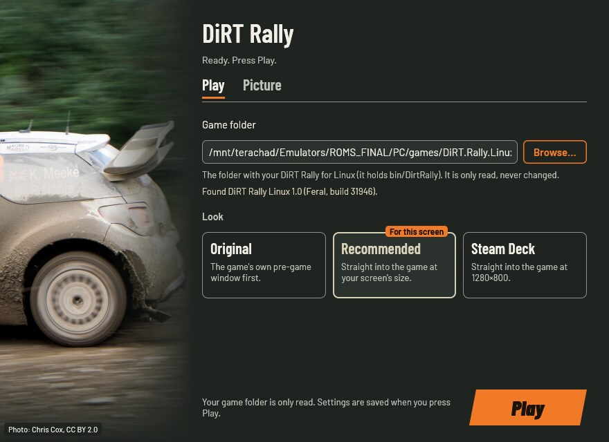
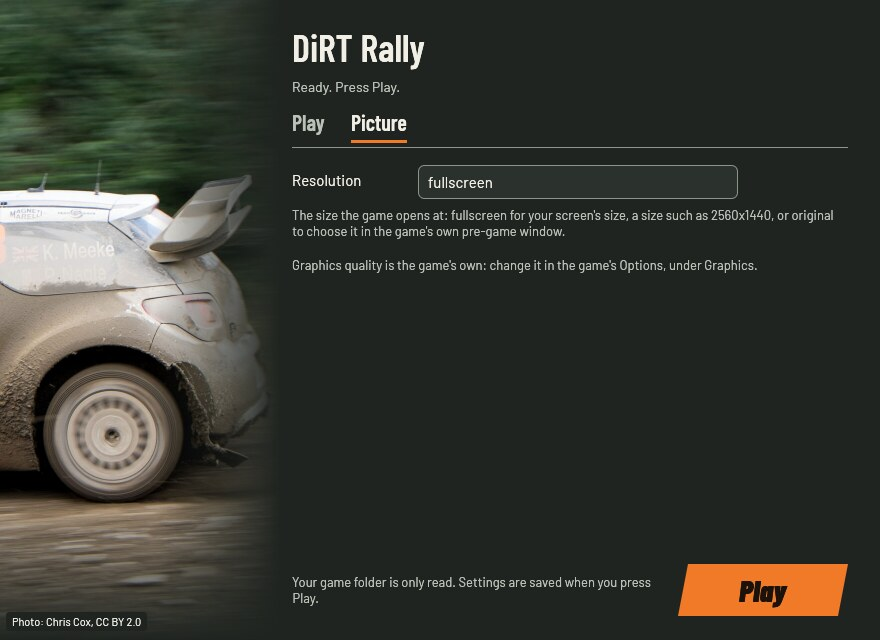
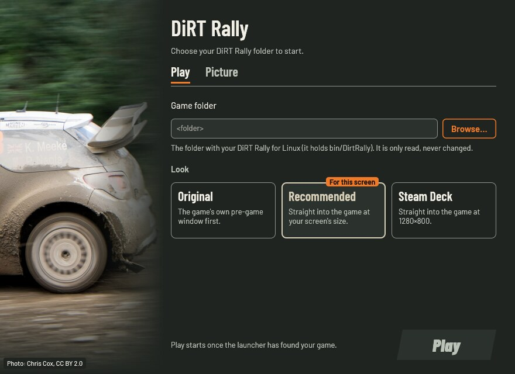
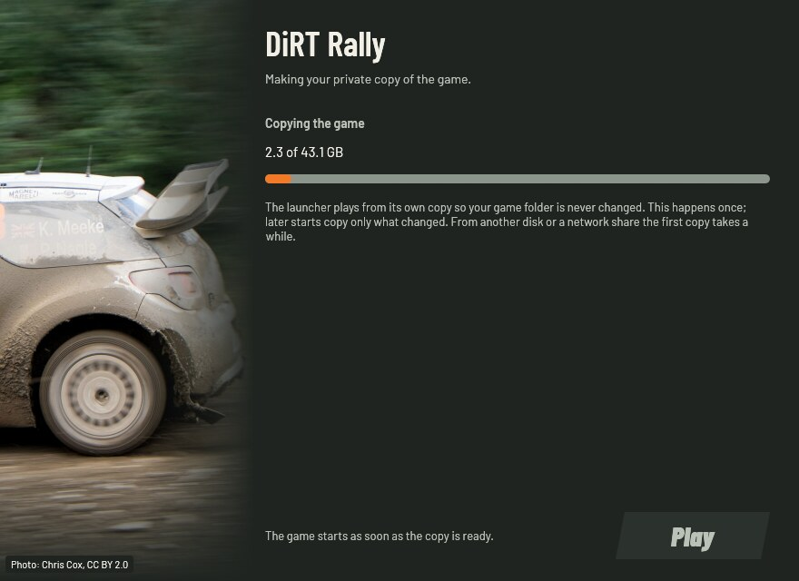

# DiRT Rally Launcher

Plays your own copy of the Linux version of **DiRT Rally** (2015) on a
modern Linux desktop. The launcher brings the old libraries the 2017 port
needs and the fix for its crash on new CPUs, so you don't have to hunt for
libraries or edit config files by hand.

Your game folder is only read, never changed: the launcher plays from a
private copy.

This project contains no game files: you need your own copy of the game.

> Played end to end on Linux (Arch, NVIDIA, 4K) with an 8BitDo pad, from
> the zip and the AppImage. Not yet: the Steam Deck and the Windows version
> of the game. Reports welcome in the
> [issues](https://github.com/akitaonrails/rea-dirt-rally/issues).

[](https://new-uploads-akitaonrails.s3.us-east-2.amazonaws.com/2026/11/02/dirt-rally-launcher/showcase-h264.mp4)

*A stage of DiRT Rally at 4K with a gamepad, started through the launcher. Click to watch.*

## Problems this launcher solves

| Without the launcher | With it |
|---|---|
| The game crashes as soon as it starts on AMD Ryzen 5000 and newer (and recent Intel) CPUs | Starts and plays normally |
| "Error while loading shared libraries": modern Linux no longer ships the old libraries the 2017 port needs | They come with the launcher and are given only to the game |
| An "Unsupported Linux distribution" warning and Feral's pre-game window at every start | The game goes straight to its intro at your screen's size |
| Newer gamepads (an 8BitDo, recent Xbox-style pads) are an unknown joystick: the game starts on the keyboard and forgets your mapping | They show up as gamepads with the game's own ready-made controls |
| On a desktop with several monitors the game can open on the wrong one | With gamescope it opens fullscreen on the monitor you are using |
| The game writes into its own folder | It plays from a private copy; your folder is only read |

## Screenshots

| Play | Picture |
|---|---|
|  |  |
|  |  |

## What you need

- **DiRT Rally for Linux**, Feral Interactive's port, version 1.0 (the
  final 2017 build). The folder holds `bin/DirtRally` and a `share`
  folder; you can choose that folder or the one just above it.
- **A copy that already runs without Steam.** DiRT Rally was withdrawn
  from sale in 2022, and the launcher has to start the game without the
  Steam client. It does not change Steam or copy-protection files, it
  does not apply cracks, and we can't and won't explain how to get such
  a copy.
- **gamescope**, if you have more than one monitor (installed on the
  system, or in a container such as the
  [distrobox-gaming](https://github.com/akitaonrails/distrobox-gaming)
  `gaming` box).
- About **40 GB** of free space for the private copy, unless the game is
  on the same disk as your home folder (then the copy takes almost no
  space).

The Windows version of the game is recognised but not supported yet: its
copy stops while loading under Wine, and the launcher says so instead of
starting it.

Any other build is refused with a code (its SHA-256). Please report it with
the [unknown edition form](https://github.com/akitaonrails/rea-dirt-rally/issues/new?template=unknown-edition.yml):
report the code, never the game file.

## Download and install

Download from the [latest release](https://github.com/akitaonrails/rea-dirt-rally/releases/latest):

### Linux

Either:

- the AppImage, `DiRTRallyLauncher-…-x86_64.AppImage`: make it executable
  (`chmod +x`) and run it in place of `linux/dirtrally-play` below; or
- the zip, `DiRTRallyLauncher-…-linux-x86_64.zip`: unpack it anywhere and
  keep its folders together.

More Linux details: [linux/README.md](linux/README.md).

### Steam Deck

Not checked yet. The same package should work in Desktop Mode; Game Mode
reports are welcome.

## First run

Start the launcher (the AppImage, or `linux/dirtrally-play` from the zip)
with no options. The settings window opens:

1. Press **Browse…** and choose your DiRT Rally folder (the one with
   `bin/DirtRally`, or the folder just above it). The window says which
   version it found, or why it can't play that folder.
2. Keep **Recommended**, or choose another look.
3. Press **Play** (or Enter, or Start on a pad).

The first Play makes the private copy of the game, with its progress in the
window. From another disk or a network share that copies about 40 GB and
takes a while (about 25 minutes from a NAS); later starts copy only what
changed. Then the game starts fullscreen at your screen's size.

`--play` starts with the saved settings and skips the window:

```sh
linux/dirtrally-play --play
linux/dirtrally-play --play --game "/path/to/DiRT Rally"   # no settings window
```

If gamescope lives in a distrobox, run it through the box (your settings
and saves stay in your own home folder):

```sh
DIRTRALLY_RUN="distrobox enter gaming --" linux/dirtrally-play
```

To quit, use the game's own **Quit**, or run `linux/dirtrally-play stop`
from another terminal.

## The settings window

- **Play** tab: the game folder (with **Browse…**) and the looks.
  **Recommended** goes straight into the game at your screen's size,
  **Steam Deck** does the same at 1280×800, and **Original** opens Feral's
  own pre-game window first, as the game shipped.
- **Picture** tab: the resolution. Graphics quality is the game's own; set
  it in the game's **Options**, under **Graphics**.
- **Play** saves the settings, makes the private copy the first time, then
  starts the game. It stays off, with the reason shown, until the launcher
  has found a version of the game it can play.

Mouse, keyboard and a gamepad all work: the D-pad moves between controls,
A changes the focused one, LB/RB switch tabs and Start plays.

## Gamepad

The game knows only the pads it shipped with in 2016, so on its own it
treats newer ones (an 8BitDo, recent Xbox-style pads) as an unknown
joystick, starts on the keyboard and forgets a hand-made mapping. The
launcher adds each pad with the standard button layout to the game's own
controller list as an Xbox 360-style pad, and the game then offers its
ready-made pad controls.

Once, with the pad on: open **Options → Controls → Controls preset** and
choose **Controller preset 1**. The buttons come mapped already.

The launcher remembers every pad it has seen, so a wireless pad that was
asleep when you started is still known; turn it on before you open the
Controls menu. Button changes and force feedback stay in the game's own
Controls menu.

## Options

| Option | What it does | Values | Unset |
|---|---|---|---|
| `look` | **Recommended**: straight into the game at your screen's size. **Steam Deck**: the same at 1280×800. **Original**: Feral's pre-game window first, as the game shipped | `recommended`, `steam_deck`, `original` | Recommended on first run |
| `resolution` | The size the game opens at | `fullscreen`, a size such as `2560x1440`, or `original` (choose it in Feral's window) | your screen's size |
| `game` | Your game folder | a folder | asked on first run |
| `runtime` | Where the private copy lives | a folder | `~/.local/share/dirtrally-launcher/runtime` |

Every option is a line in `~/.config/dirtrally-launcher/launcher.cfg`
(`look = recommended`) and a flag (`--look steam_deck`,
`--resolution 3840x2160`). Graphics quality is the game's own: change it in
its **Options → Graphics**. 4K works.

`DiRTRallyLauncher --help` lists everything; `DiRTRallyLauncher --check`
checks your game folder without starting anything.

## Where things live

| What | Where |
|---|---|
| Launcher settings and log | `~/.config/dirtrally-launcher/` (`launcher.cfg`, `launcher.log`, `play.log`; `known-pads.json` lists the pads it has seen, delete it to forget them) |
| Private copy of the game | `~/.local/share/dirtrally-launcher/runtime` |
| The game's settings | `~/.local/share/feral-interactive/DiRT Rally/` (`preferences.before-launcher` there is the game's own file as it was before the launcher first changed it) |
| Your saves (profile, career) | where your copy of the game keeps them; the copies tested here use `~/.local/share/Steam/ACTiVATED/310560/remote/` |

## Troubleshooting

- **"There is no DiRT Rally in …"**: choose the folder that holds
  `bin/DirtRally`, or the one just above it.
- **"This … is not a build this launcher knows"**: see **What you need**;
  report the code it shows (the message's **Report the edition** button
  opens the form; **Copy details** copies what to paste).
- **"The game or its launcher is already running"**: the game, or the
  settings window, is still open, so nothing was started. Close it, or run
  `linux/dirtrally-play stop`.
- **The game opens on the wrong monitor, or rotated**: use gamescope (see
  **First run**), or set `resolution` to your main monitor's size.
- **The pad does nothing in the game**: turn it on, then choose
  **Controller preset 1** in **Options → Controls → Controls preset**.
- **Anything else**: open an issue and attach `launcher.log` and
  `play.log` from `~/.config/dirtrally-launcher/` (remove personal paths
  if you like).

## Known limitations

- The Windows version of the game is not supported yet (it stops while
  loading under Wine).
- Not yet checked: the Steam Deck and wheels.
- Online features are gone for everyone: RaceNet shut down in 2025, so
  online events, leagues and their achievements no longer work. Offline
  career and single stages work.

## Uninstall

Delete the launcher's folder and its private copy
(`~/.local/share/dirtrally-launcher/`). Your game folder was never
changed. `~/.config/dirtrally-launcher/` holds only the launcher's
settings and logs. Keep the game's settings and saves (see **Where things
live**) unless you want to start over: back them up first.

## For developers

```sh
cargo test --workspace
cargo clippy --workspace --all-targets -- -D warnings
sh linux/tests/play.sh
sh packaging/tests/package.sh
packaging/package.sh --no-appimage dist/DiRTRallyLauncher-dev-linux-x86_64
```

Tests run headless and never touch your real folders. Real-game checks are
env-gated (`DIRTRALLY_GAME_DIR=… cargo test -- --ignored`) and recorded in
[docs/RUNTIME_NOTES.md](docs/RUNTIME_NOTES.md); the research behind each
fix is in [docs/RESEARCH.md](docs/RESEARCH.md). Read [AGENTS.md](AGENTS.md)
before changing anything: it holds the rules, including the owner's
decision on pre-activated copies.

## How it works

- **Editions** are identified by SHA-256 (`edition.rs`); unknown builds are
  refused.
- **The PKU crash**: the 2017 binary maps memory execute-only and then
  reads it, which faults on CPUs with memory protection keys.
  `dirtrally-exec-read`, a small `LD_PRELOAD` library, gives such mappings
  read access too.
- **Legacy libraries** (OpenSSL 1.0, libidn11, librtmp, OpenLDAP 2.4,
  GConf, …) come from pinned Steam Runtime 1 packages and reach only the
  game's process (`plan.rs`).
- **Feral's pre-game window** is skipped with the values its own decision
  reads (found by decompiling it), and the game's size is set at the same
  time; skipping without a size crashes the game (`prefs.rs`).
- **Gamepads**: a mapping per connected pad in the numbering the game's SDL
  2.0.5 uses, from sysfs (`pads.rs`).

## Built on rea-launcher-sdk

The private copy of the game, `launcher.cfg` and the option table, the
Linux helper's library (`rea-play.sh`), packaging and CI come from
[rea-launcher-sdk](https://github.com/akitaonrails/rea-launcher-sdk),
shared by every rea launcher. It is pinned by tag in `Cargo.toml` and
vendored in `sdk/` (the tag is in `sdk/VERSION`). This repository keeps
what is specific to DiRT Rally.

## Contributing

- **About DiRT Rally** (its versions, fixes, settings, `dirtrally-play`'s
  game settings, this README): issues and pull requests here.
- **Shared code** (the private copy, the option table, `rea-play.sh`,
  packaging, CI workflows, anything under `sdk/`): issues and pull
  requests at
  [rea-launcher-sdk](https://github.com/akitaonrails/rea-launcher-sdk/issues).
- **How to tell:** code under `sdk/` or from a `rea_launcher*` crate is the
  SDK's; if the same problem would happen with another rea launcher, it's
  the SDK's. Not sure? Open it here and it will be moved.
- Never patch `sdk/` or copy SDK code here: fix the SDK and bump the tag.
- Never attach game files (executables, saves, data) to an issue.

## Credits

- Feral Interactive for the Linux port, and the players who documented its
  problems: PCGamingWiki, ProtonDB, the ArchWiki, Valve's steam-runtime
  issue tracker and FeralInteractive/ferallinuxscripts issue #3 (where the
  execute-only memory crash and its `mprotect` workaround were found).
- The Steam Runtime 1 ("scout") packages, for the legacy libraries.
- gamescope, for the fullscreen session.
- The window's photo: Kris Meeke at the 2015 Wales Rally GB, by Chris Cox
  (CC BY 2.0, via Wikimedia Commons).
- quick-xml and the Rust `libc` crate.
- [rea-launcher-sdk](https://github.com/akitaonrails/rea-launcher-sdk).

Full list with licences: [THIRD_PARTY.md](THIRD_PARTY.md).

## Legal

DiRT Rally is © Codemasters; the Linux port is by Feral Interactive. This
project is not affiliated with or endorsed by them and contains no game
files. It needs a copy of the game that already runs without Steam; it does
not provide one, does not change Steam or copy-protection files, and we
can't and won't explain how to get such a copy.
Our code is MIT OR Apache-2.0 ([LICENSE-MIT](LICENSE-MIT),
[LICENSE-APACHE](LICENSE-APACHE)); bundled components keep their own
licences ([THIRD_PARTY.md](THIRD_PARTY.md)).
